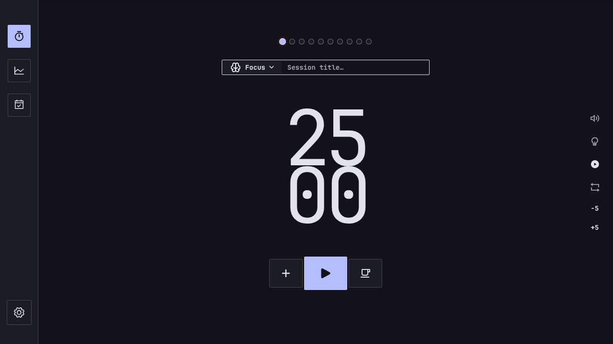

# Presto for Omarchy

A Pomodoro timer in the Omarchy bar that opens the **complete Presto application**.
There is one engine, one history, and one interface. There is no separate lite UI.



The app includes tasks, tags, quick logs, distractions, manual sessions, statistics,
calendar, notifications, ambient audio, shortcuts and an **Omarchy** theme alongside
Espresso, Pommodore64 and PipBoy. Omarchy is selected by default on Omarchy when no
explicit theme has been saved. Saved choices are preserved. The theme uses its own
light/dark palette; it does not mirror arbitrary live shell palettes.

## Requirements

- Omarchy Quattro with Quickshell plugins and Lua Hyprland configuration.
- Linux x86_64 for the prebuilt runtime; other architectures are not packaged yet.
- Python 3, systemd user services, GTK 3 and WebKitGTK 4.1 (`gtk3`, `webkit2gtk-4.1`).
- The **matching modified Presto runtime from this repository's release**, rather
  than an unrelated Presto binary. The bar requires its `--omarchy-control` interface.

The current build was tested on Omarchy 4.0.4 / Arch Linux. It dynamically links
system libraries and is not a portable build for every Linux distribution.

## Install

Install the plugin using Omarchy's standard command:

```sh
omarchy plugin add https://github.com/KonstantinKo/omarchy-presto.git --enable
```

Then download and verify the companion app. The plugin does not execute an install
hook or download software when enabled. Until the runtime is installed, the bar
shows an unavailable indicator.

```sh
mkdir -p "$HOME/Downloads/presto-omarchy-2.2.0"
cd "$HOME/Downloads/presto-omarchy-2.2.0"
curl -fLO https://github.com/KonstantinKo/omarchy-presto/releases/download/v2.2.0/presto-omarchy-2.2.0-linux-x86_64.tar.gz
curl -fLO https://github.com/KonstantinKo/omarchy-presto/releases/download/v2.2.0/SHA256SUMS
sha256sum --ignore-missing -c SHA256SUMS
tar -xzf presto-omarchy-2.2.0-linux-x86_64.tar.gz
bash "$HOME/.config/omarchy/plugins/konko.presto/install-runtime.sh" "$PWD/presto"
```

The last command explicitly installs `~/.local/bin/presto`, a user systemd service,
and `~/.config/hypr/presto.lua`, adding its include to `hyprland.lua` if necessary.
It backs up existing affected files in `~/.local/state/presto-omarchy/backups/`.
It refuses to interrupt an active or paused session. Review the script before
running it. It uses no sudo, does not change the git-managed plugin or shell layout,
and does not restart the desktop shell.

Your existing Presto data remains in its original `com.presto.app` data directory,
normally `~/.local/share/com.presto.app`. Neither installation nor removal deletes
history or settings.

## Use

- **Left-click:** open/hide full Presto immediately.
- **Right-click:** start/pause the original timer.
- **Middle-click:** hide the app.
- Closing the window hides it; the timer continues in its user service.

The bar displays Presto's own tray text, including overtime, session counts and
paused/icon-only modes. It never invents a countdown when the runtime is unavailable.
The window floats and stays pinned. Shell reloads do not restart the timer engine.

```sh
omarchy-shell konko.presto open
presto --omarchy-control status
systemctl --user status presto-omarchy.service
```

If `presto` is not on your PATH, use `~/.local/bin/presto`.

## Update

Finish any active/paused session first. Update the plugin with
`omarchy plugin update konko.presto`, then download the corresponding release,
verify its checksums and rerun `install-runtime.sh` with the new binary. Plugin
updates only update plugin files; they do not silently replace the native app.
Use the releases here for this integration, rather than Presto's separate signed
application updater.

## Remove

Finish the session you want to keep before stopping the runtime:

```sh
systemctl --user disable --now presto-omarchy.service
rm "$HOME/.config/systemd/user/presto-omarchy.service"
systemctl --user daemon-reload
omarchy plugin remove konko.presto
```

The app binary, original app data, backups and title-specific Hyprland rule are
retained. The rule is inactive without the widget window and can be kept for
reinstallation. To remove it too, remove `require("hypr.presto")` from your
`hyprland.lua`, then delete `~/.config/hypr/presto.lua` and run `hyprctl reload`.
You can separately delete `~/.local/bin/presto` if you no longer use the app.
Do not remove a binary/config file you have since replaced or customized.

## Source and license

Presto was created by Stefano Novelli and is maintained in the
[KonstantinKo/presto fork](https://github.com/KonstantinKo/presto). The native
runtime's exact source snapshot is attached to each release as
`presto-omarchy-<version>-source.tar.gz`; its commit is recorded in `BUILD.json`
in the runtime archive. The app frontend and assets are embedded in the binary.

The existing [Business Source License 1.1](LICENSE.md), including its original
attribution, use grant and change date, is preserved. This is a source-available
project; no relicensing is implied. There are no accounts, sync or telemetry.
Presto's existing update checks retain their original behavior. Linux smart pause
is not added: the original OS idle-monitoring implementation is macOS-only.

To build the native app from the source release, follow its existing build
instructions, or run `integrations/omarchy/build.sh` from the extracted source.
Do not run its source-checkout installer over this git-managed plugin; use this
repository's `install-runtime.sh` with `target/release/presto` instead.

## Development and release

```sh
omarchy plugin validate .
python3 -m unittest discover -s tests -v
QT_QPA_PLATFORM=offscreen /usr/lib/qt6/bin/qmltestrunner -input tests
python3 tools/build_release.py --source /path/to/tested/presto --output dist
(cd dist && sha256sum -c SHA256SUMS)
```

Packaging reads committed source only and refuses tracked source changes. Build
and test Presto first: this packaging tool packages the supplied binary; it does
not prove that it was compiled from the recorded revision. It never publishes.
